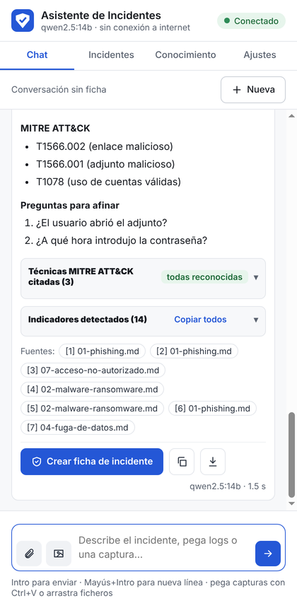
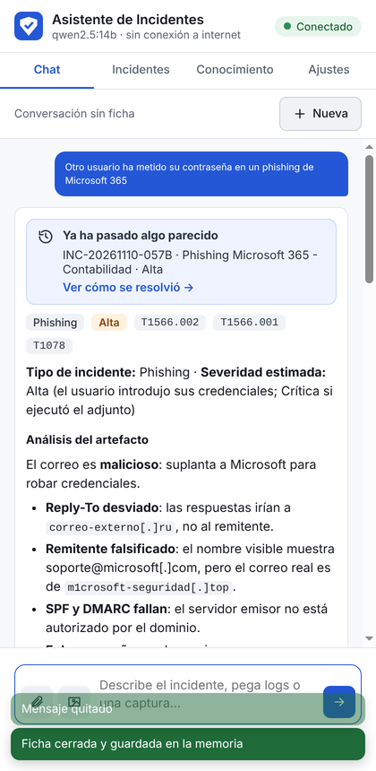
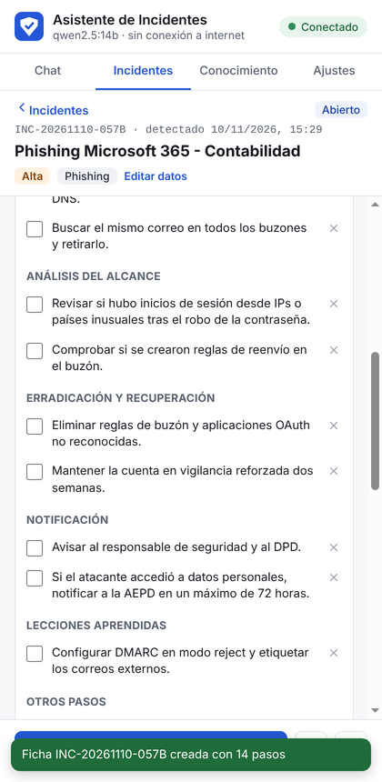

# Asistente de Incidentes de Ciberseguridad

**Extensión de Chrome que ayuda a analizar incidentes de ciberseguridad y a decidir cómo
proceder, paso a paso, con un modelo de IA que se ejecuta en tu propio equipo.**

Sin internet y sin servicios en la nube: los correos, logs y datos de tus incidentes nunca
salen del ordenador.

[](https://github.com/Fer1399/asistente-incidentes-ciberseguridad/actions/workflows/pruebas.yml)


<p align="center">
  
  
  
</p>

---

## Índice

- [Qué hace](#qué-hace)
- [Cómo funciona](#cómo-funciona)
- [Requisitos](#requisitos)
- [Instalación rápida](#instalación-rápida)
- [Primeros pasos](#primeros-pasos)
- [Funcionalidades en detalle](#funcionalidades-en-detalle)
- [Configuración](#configuración)
- [Privacidad y seguridad](#privacidad-y-seguridad)
- [Estructura del proyecto](#estructura-del-proyecto)
- [Pruebas y calidad](#pruebas-y-calidad)
- [Documentación](#documentación)
- [Problemas frecuentes](#problemas-frecuentes)
- [Limitaciones](#limitaciones)
- [Licencia y créditos](#licencia-y-créditos)

---

## Qué hace

Describes un incidente (o adjuntas un correo, un log, un PDF o una captura de pantalla) y el
asistente responde **qué hacer**, en orden:

1. **Acciones inmediatas** (primeros 15-30 minutos)
2. **Preservación de evidencias**
3. **Contención**
4. **Análisis del alcance**
5. **Erradicación y recuperación**
6. **Notificación**: interna, INCIBE-CERT o CCN-CERT, AEPD en 72 h si hay datos personales,
   denuncia, y obligaciones NIS2 y ENS
7. **Lecciones aprendidas**
8. **Técnicas MITRE ATT&CK** implicadas

Además:

| | |
|---|---|
| 📚 **Se basa en tus documentos** | Busca en una base de conocimiento local (playbooks incluidos y tus PDFs) y **cita la fuente** de cada paso |
| ✉️ **Analiza artefactos** | Correos `.eml` (SPF/DKIM/DMARC, remitente falsificado, enlaces engañosos, adjuntos peligrosos), capturas de pantalla (visión + OCR), logs y PDFs |
| 🎯 **Extrae indicadores** | IPs, dominios, URLs, correos, hashes y CVE, mostrados de forma segura (`ejemplo[.]com`) y listos para copiar |
| ✅ **Verifica MITRE ATT&CK** | Comprueba cada técnica citada contra una referencia local y muestra su nombre oficial |
| 🗂️ **Fichas de incidente** | Checklist con la hora de cada paso, cronología automática, plazo de 72 h de la AEPD, evidencias e informes en PDF |
| 🧠 **Aprende de tu experiencia** | Los incidentes cerrados y revisados pasan a la memoria: si ocurre algo parecido, te dice cómo se resolvió |
| 🔒 **Privado** | Todo se procesa en local con [Ollama](https://ollama.com); funciona sin conexión |

Incluye **7 playbooks** propios: phishing, malware y ransomware, cuenta comprometida, fuga
de datos, DDoS, fuerza bruta y acceso no autorizado.

---

## Cómo funciona

```
┌──── Chrome ────┐            ┌─────────── Backend local (Python) ───────────┐
│  Extensión     │    HTTP    │  FastAPI · 127.0.0.1:8000                     │
│  panel lateral │ ─────────► │   ├─ RAG ─────────► ChromaDB (vectores)       │
│  · Chat        │ ◄───────── │   ├─ Fichas ──────► SQLite                    │
│  · Incidentes  │  streaming │   ├─ Adjuntos ────► OCR (Tesseract)           │
│  · Conocim.    │            │   └─ IA ──────────► Ollama (127.0.0.1:11434)  │
│  · Ajustes     │            │                       chat · visión · vectores│
└────────────────┘            └───────────────────────────────────────────────┘
                     Todo en el mismo equipo · nada sale de localhost
```

1. La **extensión** envía la pregunta (y los adjuntos) al **backend local**.
2. El backend analiza los adjuntos, extrae los indicadores y genera alertas.
3. Busca en la **base de conocimiento** los fragmentos más relacionados (técnica **RAG**:
   generación aumentada por recuperación) y los incidentes anteriores parecidos.
4. Le pasa todo al **modelo de IA local** con unas instrucciones precisas.
5. La respuesta llega **en tiempo real**, con las fuentes citadas, los indicadores y las
   técnicas MITRE verificadas.

Más detalle en [docs/02-arquitectura.md](docs/02-arquitectura.md).

---

## Requisitos

| | Mínimo | Recomendado |
|---|---|---|
| Sistema operativo | Windows 10/11 de 64 bits | Windows 11 |
| Memoria RAM | 16 GB | 32 GB |
| Tarjeta gráfica | No imprescindible (funciona en la CPU, más lento) | NVIDIA con 12 GB de VRAM o más |
| Disco libre | 15 GB | 25 GB |
| Navegador | Google Chrome 116 o posterior | |

| Programa | Versión | Para qué |
|---|---|---|
| [Python](https://www.python.org) | 3.12 (o 3.11), 64 bits | Backend |
| [Ollama](https://ollama.com) | Reciente | Modelos de IA locales |
| [Tesseract OCR](https://github.com/UB-Mannheim/tesseract/wiki) | 5.x, con idioma español | PDFs escaneados y capturas (opcional, recomendado) |
| [Git](https://git-scm.com) | Cualquiera | Descargar el proyecto (opcional) |

### Modelos de IA

El instalador elige el modelo de chat según la tarjeta gráfica:

| Equipo | Modelo de chat | Tiempo típico de respuesta |
|---|---|---|
| GPU NVIDIA con 12 GB de VRAM o más | `qwen2.5:14b` | 10-30 s |
| Resto de equipos | `qwen2.5:7b` | De segundos (con GPU) a varios minutos (solo CPU) |

Además: `bge-m3` para la búsqueda (obligatorio) y `qwen2.5vl:7b` para las capturas (opcional).

---

## Instalación rápida

En **PowerShell como administrador**:

```powershell
# 1. Programas necesarios
winget install -e --id Python.Python.3.12
winget install -e --id Ollama.Ollama
winget install -e --id UB-Mannheim.TesseractOCR   # marca "Spanish" en los idiomas
winget install -e --id Git.Git
```

**Cierra PowerShell, abre una ventana nueva** y continúa:

```powershell
# 2. Descargar el proyecto
cd $HOME\Documents
git clone https://github.com/Fer1399/asistente-incidentes-ciberseguridad.git
cd asistente-incidentes-ciberseguridad

# 3. Instalar (crea el entorno, elige el modelo y lo descarga; tarda un rato)
powershell -ExecutionPolicy Bypass -File scripts\instalar.ps1

# 4. Arrancar el backend (deja la ventana abierta)
scripts\iniciar.bat
```

**5. Cargar la extensión en Chrome:**

1. Abre `chrome://extensions` y activa **Modo de desarrollador** (arriba a la derecha).
2. Pulsa **Cargar descomprimida** y elige la carpeta **`extension`** del proyecto.
3. Fija el icono con la chincheta del menú de extensiones y púlsalo.

Si arriba a la derecha del panel pone **Conectado**, ya está listo.

> Guía completa, opciones del instalador, instalación sin internet y solución de problemas:
> [docs/01-instalacion.md](docs/01-instalacion.md).

---

## Primeros pasos

### Uso diario

1. Ejecuta `scripts\iniciar.bat` y deja la ventana abierta.
2. Abre el panel con el icono de la extensión.

### Prueba con el correo de ejemplo

1. En la pestaña **Chat**, pulsa el **clip** y elige `backend\tests\muestras\phishing-ejemplo.eml`
   (un phishing ficticio incluido en el proyecto).
2. Escribe: *Un usuario ha introducido su contraseña en el enlace de este correo. ¿Cómo procedo?*
3. Revisa el análisis automático del correo, la respuesta, las fuentes y los indicadores.
4. Pulsa **Crear ficha de incidente**, marca algunos pasos y, al terminar, **Cerrar y guardar**.
5. Descarga el **Informe** en PDF.

Recorrido completo con capturas: [docs/03-guia-de-uso.md](docs/03-guia-de-uso.md).

---

## Funcionalidades en detalle

### Chat
- Respuestas en tiempo real, con botón para detenerlas.
- Adjuntos: clip (correos, logs, PDF), botón de captura, **Ctrl+V** para pegar capturas o
  arrastrar ficheros al panel.
- Citas `[n]` que muestran el fragmento de la fuente.
- Indicadores detectados, copiables uno a uno o todos.
- Verificación de las técnicas MITRE ATT&CK citadas.
- Aviso **Ya ha pasado algo parecido** con enlace al incidente anterior.

### Análisis de artefactos

| Artefacto | Qué se hace |
|---|---|
| Correo `.eml` | Cabeceras, SPF/DKIM/DMARC, Reply-To y Return-Path, nombre visible falsificado, enlaces cuyo texto no coincide con el destino, adjuntos peligrosos y dobles extensiones (sin abrirlos: solo su SHA-256) |
| Captura de pantalla | Modelo de visión (qué es, texto relevante, señales sospechosas) + OCR para el texto exacto |
| Log, CSV, JSON, XML | Indicadores del fichero completo; al modelo, el principio y el final si es muy largo |
| PDF | Texto de cada página, con OCR en las escaneadas |

### Fichas de incidente
- Se crean desde la respuesta: tipo, severidad y **checklist por fases** automáticos.
- Hora de cada paso marcado y **cronología** automática.
- **Plazo de 72 horas** para notificar a la AEPD cuando hay datos personales.
- Indicadores, evidencias con su hash, notas y conversación.
- **Cierre revisado**: se escribe lo que se hizo realmente y las lecciones aprendidas.
- **Informe** en Markdown o PDF.

### Memoria de incidentes
Solo los incidentes **cerrados y revisados por una persona** pasan a la memoria. Así el
asistente aprende de procedimientos validados, no de sus propias respuestas.

### Base de conocimiento
- 7 playbooks y una referencia de 127 técnicas MITRE ATT&CK incluidos.
- Añade tus PDFs (guías, normativa, procedimientos internos) arrastrándolos a la pestaña
  **Conocimiento**. Recomendaciones de guías oficiales: [docs/fuentes-recomendadas.md](docs/fuentes-recomendadas.md).

### Menú contextual
Selecciona texto en cualquier web, botón derecho → **Analizar con el asistente**.

### Copia de seguridad
Exporta e importa un `.zip` con incidentes, documentos y adjuntos. Importar **fusiona** con
lo que ya hay, sin borrar nada, y antes guarda una copia del estado actual. Explicación
completa, con capturas y cómo volver atrás: [docs/10-resultados.md](docs/10-resultados.md#6-copia-de-seguridad-exportar-e-importar).

---

## Configuración

`scripts\instalar.ps1` crea `backend\.env`. Los ajustes principales:

| Variable | Por defecto | Descripción |
|---|---|---|
| `CHAT_MODEL` | según la GPU | Modelo que genera las respuestas |
| `VISION_MODEL` | `qwen2.5vl:7b` | Modelo para describir capturas |
| `EMBED_MODEL` | `bge-m3` | Modelo de embeddings (si se cambia, hay que reindexar) |
| `VISION_ACTIVA` | `true` | `false` para analizar las capturas solo con OCR (más rápido sin GPU) |
| `DOMINIOS_PROPIOS` | vacío | Dominios de tu organización, separados por comas: sus indicadores se marcan como propios |
| `FRAGMENTOS_POR_CONSULTA` | `6` | Fragmentos de la base de conocimiento por pregunta |
| `TEMPERATURA` | `0.2` | Más bajo = respuestas más estables |

Todas las opciones están comentadas en [`backend/.env.example`](backend/.env.example) y en
[docs/05-asistente.md](docs/05-asistente.md#ajustes-backendenv). El modelo de chat y el uso
de la visión también se pueden cambiar desde la pestaña **Ajustes** de la extensión.

---

## Privacidad y seguridad

- **Nada sale del equipo**: el backend solo escucha en `127.0.0.1` y solo habla con Ollama
  local; la extensión solo puede conectar con `localhost`.
- **Permisos mínimos**: la extensión no puede leer las páginas que visitas.
- **Contenido malicioso tratado como datos**: nunca se ejecutan adjuntos ni se interpreta el
  HTML de correos o respuestas; los enlaces no son clicables.
- **Tus datos no se publican**: `data/`, `.env` y las copias están excluidos de Git.

Modelo de amenazas, medidas detalladas y cómo informar de una vulnerabilidad:
[SECURITY.md](SECURITY.md).

---

## Estructura del proyecto

```
asistente-incidentes-ciberseguridad/
├── backend/             API local en Python (FastAPI)
│   ├── app/             código del asistente
│   ├── evaluacion/      batería de evaluación con el modelo real
│   ├── tests/           pruebas automáticas, Ollama simulado y prueba de la extensión
│   ├── preguntar.py     consola alternativa a la extensión
│   └── run.py           arranque
├── extension/           extensión de Chrome (JavaScript, sin dependencias)
├── knowledge/           playbooks y referencia MITRE (se indexan al arrancar)
├── scripts/             instalar, arrancar, preguntar y evaluar (Windows)
├── docs/                documentación y capturas
└── data/                tus datos (se crea al arrancar; nunca se sube a Git)
```

---

## Pruebas y calidad

| Tipo | Qué comprueba | Cómo ejecutarlo |
|---|---|---|
| Pruebas automáticas (55) | Backend completo con modelos simulados | `cd backend` y `.venv\Scripts\python.exe -m pytest` (antes, `pip install -r requirements-dev.txt`) |
| Prueba de la extensión | La extensión en Chrome real, de principio a fin | [docs/08-extension.md](docs/08-extension.md#prueba-automática-de-la-extensión) |
| Evaluación de respuestas | Calidad de las respuestas del modelo real en 15 incidentes tipo | `scripts\evaluar.bat` · [docs/09-evaluacion.md](docs/09-evaluacion.md) |
| GitHub Actions | Pruebas y comprobaciones de la extensión en cada cambio | Automático |

Resultados de una prueba real con `qwen2.5:14b` (respuesta a un ransomware en 14,3 s, con
las 8 técnicas MITRE verificadas): [docs/10-resultados.md](docs/10-resultados.md).

---

## Documentación

| Documento | Contenido |
|---|---|
| [01 · Instalación](docs/01-instalacion.md) | Requisitos, instalación paso a paso, actualización, instalación sin internet, problemas frecuentes |
| [02 · Arquitectura](docs/02-arquitectura.md) | Componentes, flujo de una pregunta, código, datos y API |
| [03 · Guía de uso](docs/03-guia-de-uso.md) | Un incidente de principio a fin, con capturas |
| [04 · Base de conocimiento y RAG](docs/04-rag.md) | Cómo se leen, trocean, vectorizan y buscan los documentos |
| [05 · El asistente](docs/05-asistente.md) | Instrucciones del modelo, playbooks, verificación MITRE, consola y ajustes |
| [06 · Correos, logs y capturas](docs/06-adjuntos.md) | Análisis de artefactos e indicadores de compromiso |
| [07 · Fichas, memoria, informes y copias](docs/07-incidentes.md) | Ciclo de vida de un incidente, plazo de la AEPD, memoria, informes y copias de seguridad |
| [08 · La extensión de Chrome](docs/08-extension.md) | Instalación, cada pestaña, menú contextual y prueba automática |
| [09 · Evaluar las respuestas](docs/09-evaluacion.md) | Batería de casos de prueba y métricas |
| [10 · Resultados](docs/10-resultados.md) | Prueba real con capturas y la copia de seguridad (exportar e importar) explicada paso a paso |
| [Fuentes recomendadas](docs/fuentes-recomendadas.md) | Guías oficiales para la base de conocimiento |
| [Registro de decisiones](docs/decisiones.md) | Cada decisión de diseño y su motivo |
| [Seguridad](SECURITY.md) | Modelo de amenazas y medidas |
| [Cambios](CHANGELOG.md) | Historial de versiones |

---

## Problemas frecuentes

| Síntoma | Solución |
|---|---|
| El panel muestra **Sin backend** | Ejecuta `scripts\iniciar.bat` y deja la ventana abierta |
| El panel muestra **Ollama apagado** o **Faltan modelos** | Abre Ollama desde el menú Inicio; revisa los modelos en **Ajustes** |
| *Falta el archivo de manifiesto* al cargar la extensión | Elige la carpeta `extension`, no la raíz del proyecto |
| Error de `numpy` al instalar | Usa Python 3.12 de 64 bits (`py -0p` para ver las versiones instaladas) |
| Respuestas muy lentas | Normal sin GPU: desactiva la visión en **Ajustes** o elige un modelo más pequeño |
| No aparece *Analizar con el asistente* | Recarga la extensión en `chrome://extensions` |

Más casos en [docs/01-instalacion.md](docs/01-instalacion.md#problemas-frecuentes).

---

## Limitaciones

- **Es una herramienta de apoyo.** Las decisiones durante un incidente real las toma, y es
  responsable de ellas, la persona que lo gestiona. Revisa siempre las respuestas,
  especialmente lo que no lleve cita.
- Los modelos locales pueden equivocarse u omitir pasos; los de mayor tamaño aciertan más.
- La normativa (plazos, NIS2, ENS) cambia: mantén actualizada la base de conocimiento con las
  guías oficiales.
- Pensado para **un equipo y una persona**: no tiene usuarios ni control de acceso.
- Los scripts de instalación son para Windows. El backend y la extensión funcionan en Linux y
  macOS, pero allí la instalación es manual.

---

## Licencia y créditos

Publicado bajo la [licencia MIT](LICENSE): puedes usarlo, modificarlo y distribuirlo
citando la autoría. Se ofrece **sin garantía**.

Construido con [Ollama](https://ollama.com), [Qwen2.5](https://github.com/QwenLM/Qwen2.5),
[BGE-M3](https://huggingface.co/BAAI/bge-m3), [FastAPI](https://fastapi.tiangolo.com),
[ChromaDB](https://www.trychroma.com), [PyMuPDF](https://pymupdf.readthedocs.io) y
[Tesseract OCR](https://github.com/tesseract-ocr/tesseract). Las técnicas de ataque proceden
de [MITRE ATT&CK®](https://attack.mitre.org), marca registrada de The MITRE Corporation.
