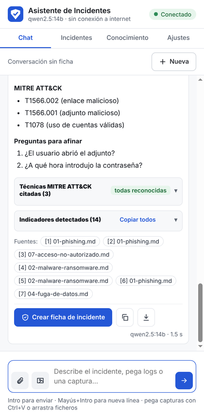
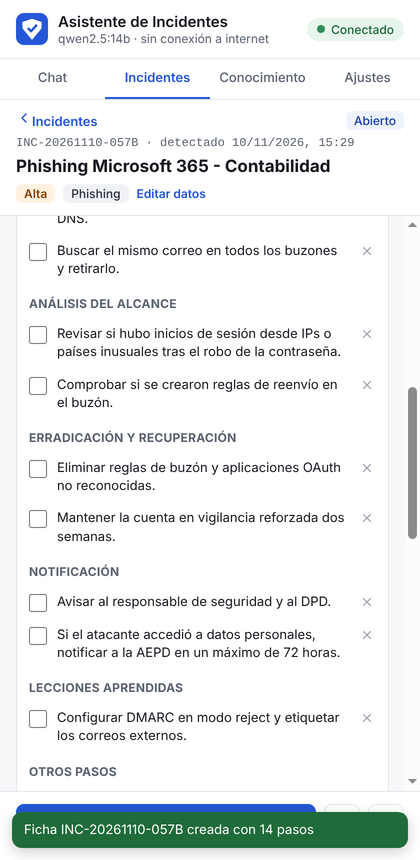
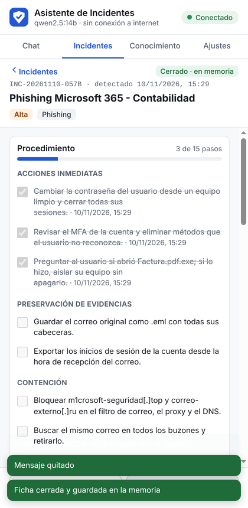
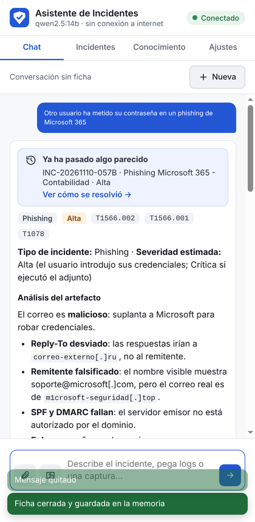

# 03 · Guía de uso: un incidente de principio a fin

Esta guía recorre un caso completo con el correo de phishing de ejemplo incluido en el
proyecto (`backend\tests\muestras\phishing-ejemplo.eml`). Se supone que el backend está en
marcha y la extensión cargada ([instalación](01-instalacion.md)).

---

## 1. Describir el incidente

1. Abre el panel con el icono de la extensión. Arriba a la derecha debe poner **Conectado**.
2. En **Chat**, pulsa el **clip** y elige el correo `.eml` (también puedes arrastrarlo al panel).
   En unos segundos aparece analizado: *7 alertas · 14 IOCs*.
3. Escribe la pregunta y pulsa **Intro**:

   > Un usuario ha introducido su contraseña en el enlace de este correo hace 20 minutos. ¿Cómo procedo?

## 2. Leer la respuesta

Arriba, la tarjeta **Análisis automático** con las alertas del correo (Reply-To desviado,
remitente falsificado, SPF y DMARC fallidos, enlace engañoso, adjunto peligroso). Después,
la respuesta del asistente:

- **Tipo y severidad**, en rango si depende de algo que aún no se sabe.
- **Análisis del artefacto** y los **siete apartados** del procedimiento.
- **Citas `[n]`**: púlsalas para ver el fragmento del playbook del que sale cada paso.
- **Técnicas MITRE ATT&CK citadas**: con su nombre oficial; si alguna no está en la
  referencia, aparece marcada.
- **Indicadores detectados**: pulsa uno para copiarlo desactivado, o *Copiar todos* para
  pegarlos en el filtro de correo o en el firewall.

Puedes seguir preguntando: *"¿Y si también abrió el adjunto?"*.

## 3. Crear la ficha

Pulsa **Crear ficha de incidente**. Pon un título, marca **Hay datos personales afectados**
si el buzón tiene datos de clientes o empleados, y crea la ficha.

La ficha contiene:
- El **procedimiento** como checklist por fases.
- La **cuenta atrás de 72 h** para notificar a la AEPD, si hay datos personales.
- Los **indicadores**, las **evidencias** (el correo con su SHA-256 y sus alertas), la
  **conversación** y la **cronología**.

Desde ahora, lo que preguntes en el Chat se guarda en la ficha.

## 4. Trabajar el incidente

- **Marca cada paso** al hacerlo: queda la hora, y la cronología se construye sola.
- **Añade pasos propios** al final de la checklist (elige la fase).
- **Quita pasos** que no apliquen con la ✕.
- **Añade notas** a la cronología (*"El usuario confirma que no abrió el adjunto"*).
- **Editar datos**: corrige la severidad o la descripción si cambia la situación.
- **Conversación**: quita mensajes que no aporten antes de generar el informe.

## 5. Cerrar y guardar en memoria

Pulsa **Cerrar y guardar** y escribe **lo que se hizo realmente** (obligatorio) y las
**lecciones aprendidas**. Con *Guardar en la memoria del asistente* activado, el incidente
pasa a la memoria.

## 6. Generar el informe

En la ficha, **Informe** → **PDF** (o Markdown). Incluye resumen, cronología, procedimiento
con la hora de cada paso, indicadores, evidencias, cierre y, si quieres, las consultas al
asistente.

## 7. La próxima vez

Cuando llegue otro caso parecido, el asistente lo reconocerá:

- Aviso **Ya ha pasado algo parecido**, con enlace a la ficha.
- La respuesta empieza con *Incidente similar anterior*: qué se hizo y qué conviene repetir.

---

## Otros usos

| Quiero… | Cómo |
|---|---|
| Analizar un texto de una web (webmail, SIEM, alerta) | Selecciónalo → botón derecho → **Analizar con el asistente** |
| Analizar una captura | Icono de imagen, o **Ctrl+V** en el cuadro de mensaje |
| Analizar un log | Clip → `.log`, `.txt`, `.csv`… (para el Visor de eventos, exporta a `.csv` o `.xml`) |
| Añadir guías propias | Pestaña **Conocimiento** → arrastra los PDFs |
| Comprobar qué sabe sobre algo | **Conocimiento** → *Probar una búsqueda* |
| Usar un modelo más rápido | **Ajustes** → *Modelo de chat* |
| Hacer una copia de seguridad | **Ajustes** → *Exportar* |
