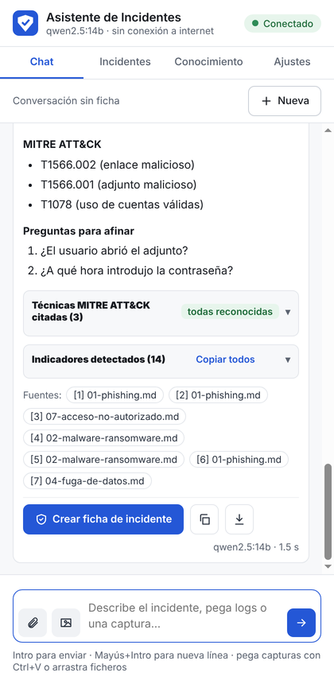
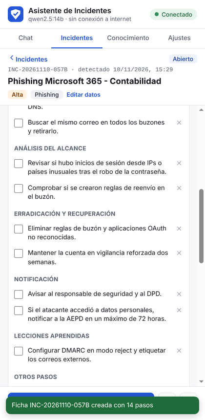
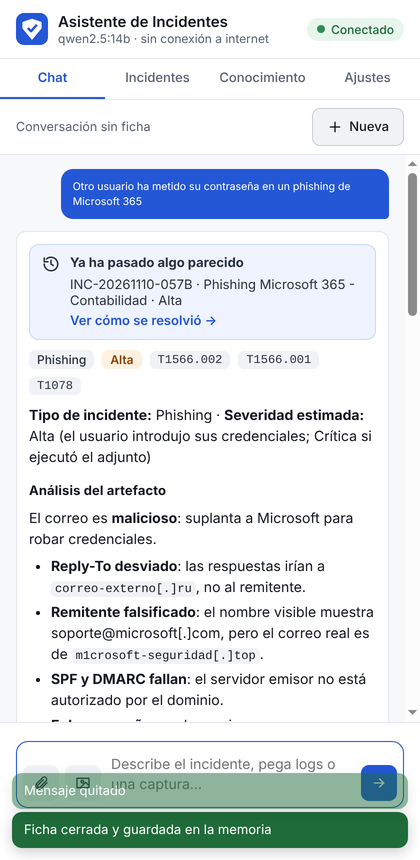

# 08 · La extensión de Chrome

La extensión es la interfaz del asistente: un **panel lateral** de Chrome que permanece
abierto mientras navegas. Habla únicamente con el backend local (`127.0.0.1:8000`).

<p>
  
  
  
</p>

---

## Instalación

La extensión no está en la Chrome Web Store: se carga desde la carpeta del proyecto.

1. Asegúrate de que el backend funciona (<http://127.0.0.1:8000/health>).
2. En Chrome, abre `chrome://extensions`.
3. Activa **Modo de desarrollador** (arriba a la derecha).
4. Pulsa **Cargar descomprimida** y elige la carpeta **`extension`** del proyecto
   (por ejemplo `<carpeta-del-proyecto>\extension`).
   Ojo: la carpeta `extension`, no la raíz del proyecto.
5. Fija el icono: menú de extensiones (pieza de puzle) → chincheta junto a
   *Asistente de Incidentes*.
6. Pulsa el icono: se abre el panel lateral.

Requiere Chrome 116 o posterior.

### Actualizar

Al descomprimir una versión nueva del proyecto, ve a `chrome://extensions` y pulsa el
botón de **recargar** (flecha circular) de la tarjeta del asistente. Tus conversaciones y
ajustes se conservan.

---

## Las pestañas

### Chat

- Escribe el incidente y pulsa **Intro** (Mayús+Intro para una línea nueva).
- **Adjuntar**: el clip para correos `.eml`, logs y PDF; el icono de imagen para capturas.
  También puedes **pegar una captura con Ctrl+V** o **arrastrar ficheros** al panel. Cada
  adjunto se analiza al momento y muestra sus alertas e indicadores antes de enviarlo.
- La respuesta aparece **según se genera**. El botón de enviar se convierte en *detener*.
- Encima de la respuesta: tipo, severidad y técnicas MITRE detectadas.
- **Ya ha pasado algo parecido**: si hay un incidente cerrado similar, aparece un aviso con
  enlace a la ficha.
- **Citas `[n]`**: púlsalas para ver el fragmento de la fuente.
- **Indicadores detectados**: pulsa uno para copiarlo (siempre desactivado, `ejemplo[.]com`).
  Los de trazo discontinuo son IPs internas o dominios legítimos.
- **Crear ficha de incidente** convierte la respuesta en una ficha. Desde ese momento, la
  conversación se guarda en ella (lo indica la barra superior).
- **Nueva** empieza otra conversación.

### Incidentes

Cifras (abiertos, en memoria, resolución media), buscador, filtros y la lista de fichas,
con su severidad, el avance de los pasos y las horas que quedan del plazo de la AEPD.
**Nuevo** crea una ficha vacía.

### Ficha de incidente

- **Procedimiento**: checklist por fases. Al marcar un paso queda la hora. Puedes añadir
  pasos propios (elige la fase) y quitar los que no apliquen.
- **Plazo de 72 h** de la AEPD si hay datos personales afectados.
- **Indicadores** (con *Copiar los del atacante*), **evidencias** con su SHA-256 y alertas,
  y **cronología** con notas.
- **Editar datos**: título, tipo, severidad, descripción y datos personales.
- **Cerrar y guardar**: pide lo que se hizo (obligatorio) y las lecciones aprendidas, y la
  guarda en la memoria del asistente.
- **Conversación con el asistente**: los mensajes guardados en la ficha. Quita los que no
  aporten (pruebas, comandos escritos por error) para que no salgan en el informe.
- **Preguntar al asistente**: continúa la conversación de la ficha en el Chat.
- **Informe**: Markdown o PDF, con o sin el anexo de consultas al asistente.

### Conocimiento

Arrastra PDFs (o `.md`, `.txt`) para añadirlos a la base de conocimiento; verás el progreso
del indexado. **Probar una búsqueda** muestra qué fragmentos recupera el asistente.

### Ajustes

- **Estado** del backend, Ollama, modelos y OCR.
- **Modelo de chat**: elige entre los modelos instalados en Ollama sin tocar el `.env`
  (por ejemplo, uno más pequeño si las respuestas tardan demasiado).
- **Visión**: desactívala en equipos sin GPU para analizar capturas solo con OCR.
- **Copia de seguridad**: exportar e importar (ver [07](07-incidentes.md#copia-de-seguridad-entre-equipos)).
- **Conexión**: dirección del backend (solo se admiten `127.0.0.1` y `localhost`).

---

## Menú contextual

Selecciona texto en cualquier web (un correo en el webmail, una alerta del SIEM, un log),
pulsa con el botón derecho y elige **Analizar con el asistente**. Se abre el panel con el
texto citado en el cuadro de mensaje, para que lo revises y añadas tu pregunta antes de
enviarlo. La extensión **no lee las páginas por su cuenta**: solo el texto que seleccionas.

---

## Seguridad y privacidad

| Aspecto | Cómo se resuelve |
|---|---|
| Red | La política de seguridad (CSP) solo permite conectar con `127.0.0.1` y `localhost`. No hay CDN, fuentes web ni analítica |
| Permisos | `sidePanel`, `contextMenus`, `storage` y acceso a `127.0.0.1`/`localhost`. **No** pide acceso a las páginas que visitas |
| Contenido malicioso | Las respuestas, correos y logs se muestran como texto: nunca se interpreta su HTML. Los enlaces no son clicables |
| Datos en el navegador | Solo la conversación actual y los ajustes (`chrome.storage.local`). Los incidentes y documentos están en el backend (`data\`) |

---

## Problemas frecuentes

| Síntoma | Solución |
|---|---|
| *Falta el archivo de manifiesto* al cargarla | Has elegido la raíz del proyecto: elige la carpeta `extension` |
| Indicador **Sin backend** | Arranca `scripts\iniciar.bat` y deja la ventana abierta |
| Indicador **Ollama apagado** o **Faltan modelos** | Abre Ollama; revisa los modelos en Ajustes |
| No aparece *Analizar con el asistente* | Recarga la extensión en `chrome://extensions` (el menú se crea al instalarla) |
| Los cambios de una versión nueva no se ven | Pulsa recargar en la tarjeta de la extensión |

---

## Prueba automática de la extensión

`backend/tests/e2e/prueba_extension.py` carga la extensión en un Chrome real y recorre todo:
chat con adjunto, citas, crear ficha, marcar pasos, cerrar, aviso de incidente similar,
conocimiento, ajustes, copia de seguridad y menú contextual, haciendo capturas y
comprobando que no hay errores en la consola.

Para que el resultado no dependa del modelo, se usa un **Ollama simulado**
(`backend/tests/ollama_simulado.py`) con respuestas fijas. Con Ollama parado:

```powershell
cd backend
.venv\Scripts\python.exe -m pip install playwright
# Terminal 1: Ollama simulado
.venv\Scripts\python.exe -m uvicorn tests.ollama_simulado:app --port 11434
# Terminal 2: backend con datos de prueba y umbrales para el simulador
$env:DATA_DIR="data-prueba"; $env:SIMILITUD_MINIMA="0.05"; $env:SIMILITUD_INCIDENTE="0.1"
.venv\Scripts\python.exe run.py
# Terminal 3: la prueba
.venv\Scripts\python.exe tests\e2e\prueba_extension.py capturas "C:\Program Files\Google\Chrome\Application\chrome.exe"
```

El simulador también sirve para enseñar el proyecto en un equipo sin Ollama.
