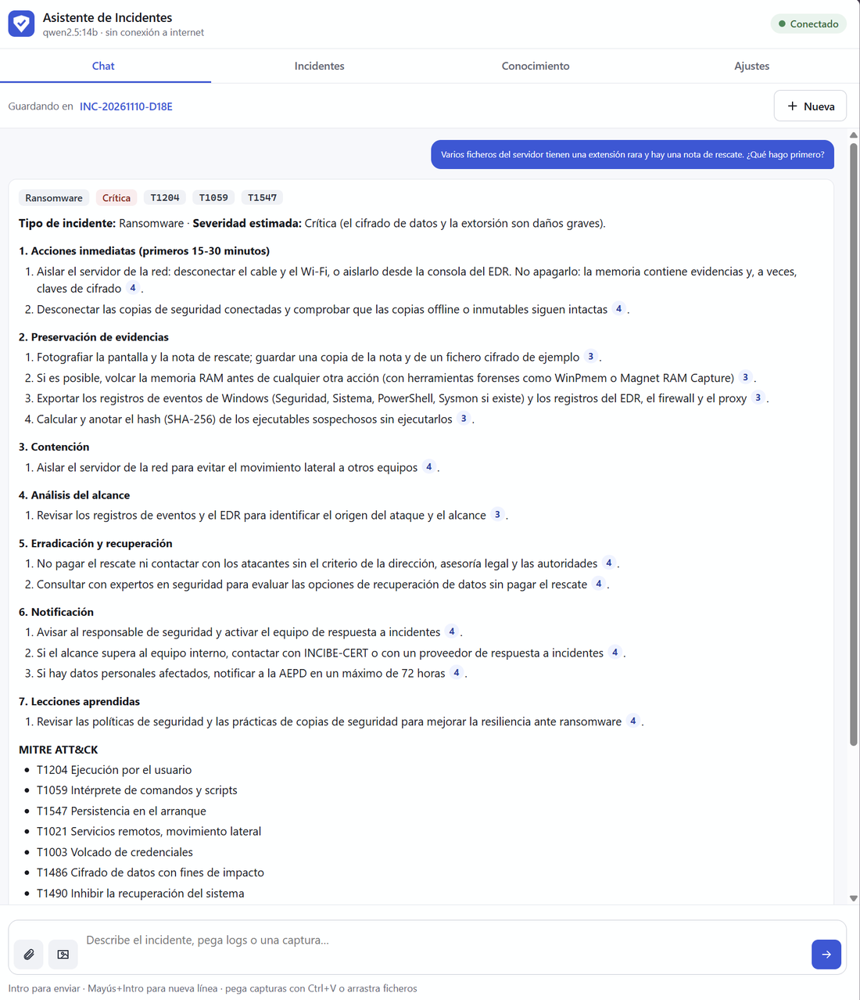
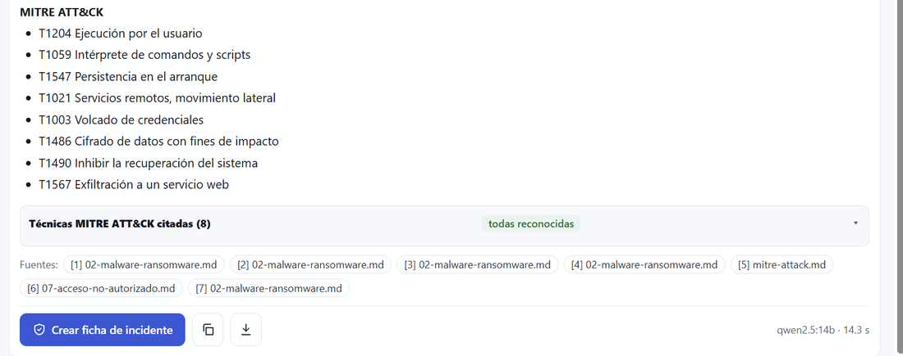
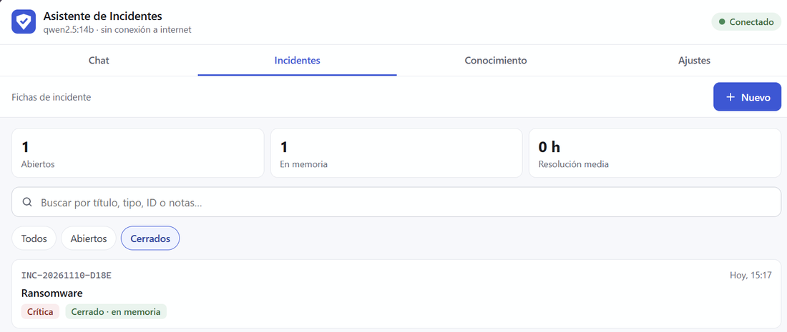
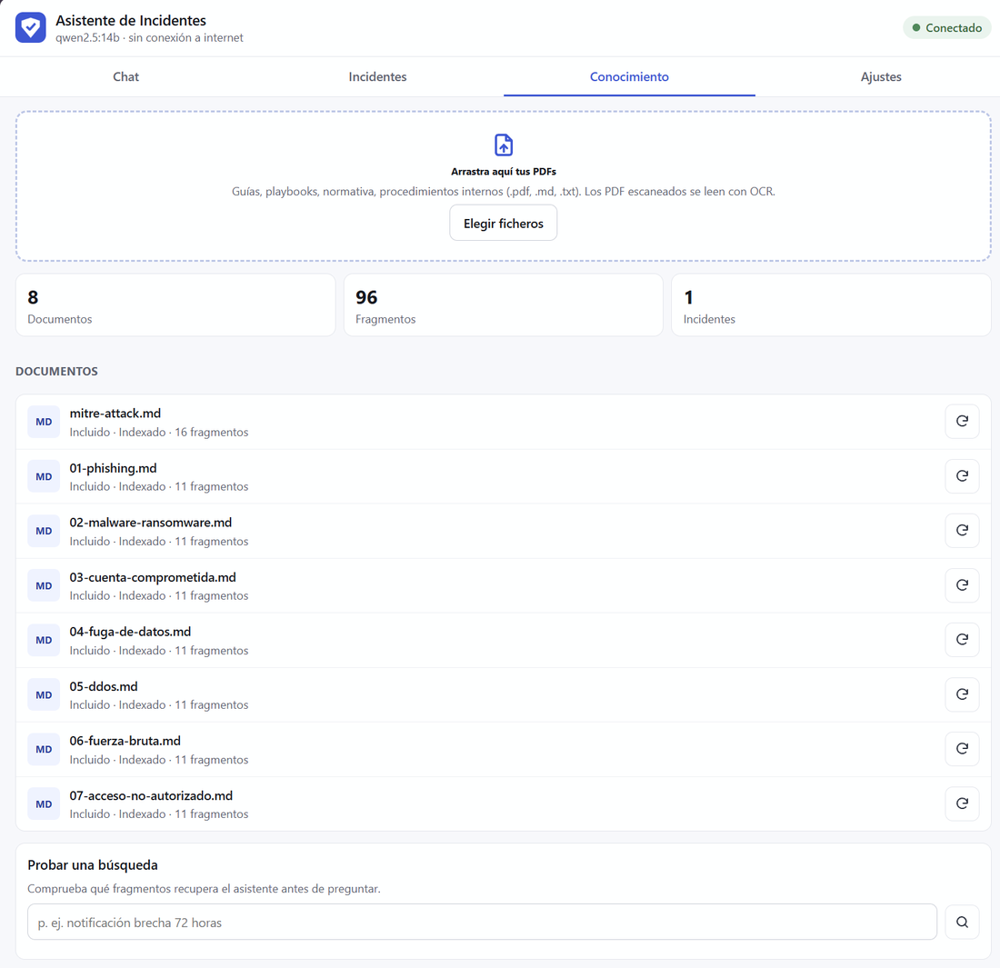
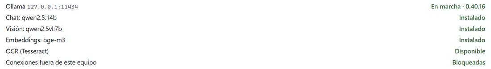
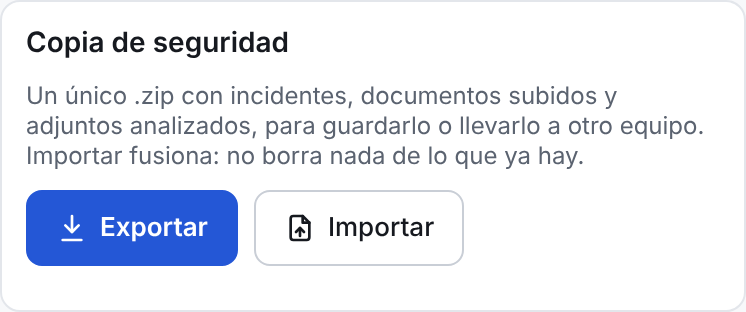
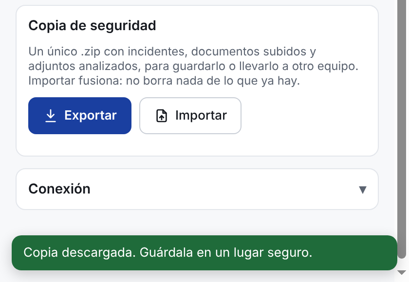
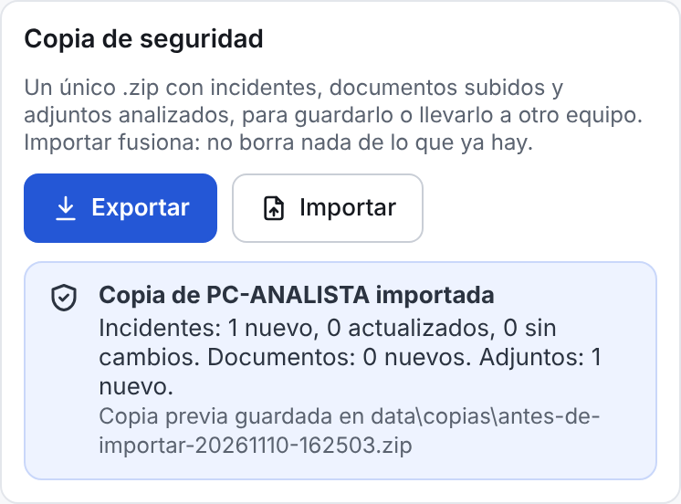
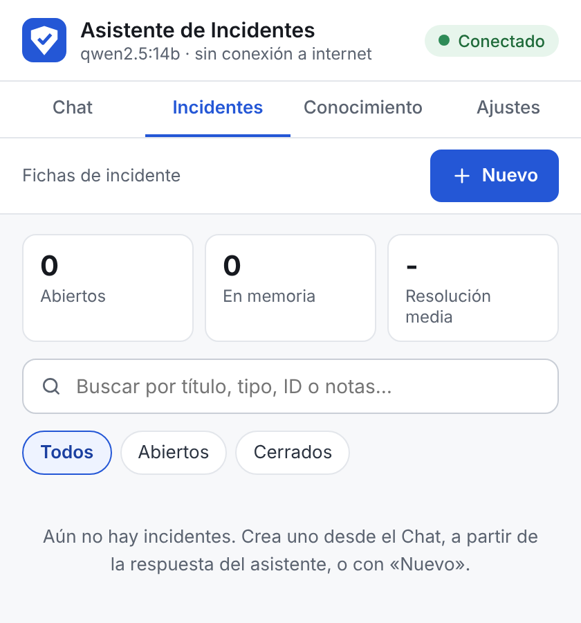
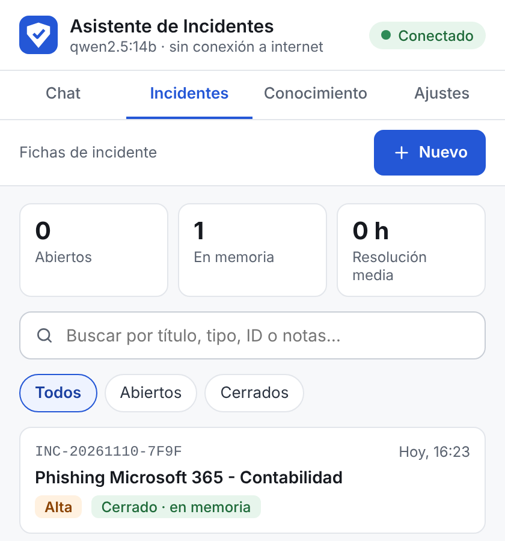

# 10 · Resultados

Este documento recoge pruebas reales del asistente con modelos locales: una consulta de
**ransomware** de principio a fin, la ficha de incidente que generó, el estado de la base de
conocimiento y, en detalle, cómo funciona la **copia de seguridad** (exportar e importar).

Las capturas de los apartados 2 a 5 son de un equipo real con Ollama. Las del apartado 6
se hicieron con la prueba automática de la extensión ([08](08-extension.md#prueba-automática-de-la-extensión)),
que simula dos equipos con datos de ejemplo.

## Índice

1. [Entorno de prueba](#1-entorno-de-prueba)
2. [Caso real: ransomware en un servidor](#2-caso-real-ransomware-en-un-servidor)
3. [La ficha del incidente](#3-la-ficha-del-incidente)
4. [Base de conocimiento](#4-base-de-conocimiento)
5. [Estado del sistema](#5-estado-del-sistema)
6. [Copia de seguridad: exportar e importar](#6-copia-de-seguridad-exportar-e-importar)
7. [Conclusiones](#7-conclusiones)

---

## 1. Entorno de prueba

| | |
|---|---|
| Sistema | Windows 11, Google Chrome |
| Hardware | 32 GB de RAM · GPU NVIDIA GeForce RTX 4080 SUPER (16 GB de VRAM) |
| Ollama | 0.40.16, en local (`127.0.0.1:11434`) |
| Modelo de chat | `qwen2.5:14b`, el que elige el instalador con 12 GB de VRAM o más |
| Modelo de visión | `qwen2.5vl:7b` |
| Embeddings | `bge-m3` |
| OCR | Tesseract (español e inglés) |
| Base de conocimiento | Los 7 playbooks incluidos y la referencia MITRE ATT&CK |
| Conexión a internet | No se usa: el backend solo acepta conexiones de `127.0.0.1` |

---

## 2. Caso real: ransomware en un servidor

**Pregunta**, tal como la escribiría alguien que acaba de encontrarse el problema:

> Varios ficheros del servidor tienen una extensión rara y hay una nota de rescate. ¿Qué hago primero?

### La respuesta

<p align="center">
  
</p>

El asistente:

- **Clasifica** el incidente como *Ransomware* con severidad *Crítica* y explica por qué.
  Las etiquetas de la parte superior resumen esa línea y las técnicas MITRE citadas.
- **Ordena lo urgente primero**: aislar el servidor de la red **sin apagarlo** (la memoria
  puede contener evidencias y claves de cifrado) y proteger las copias de seguridad antes
  de que también se cifren.
- **Preserva evidencias** antes de tocar nada: fotografía de la nota, volcado de RAM con
  herramientas concretas (WinPmem, Magnet RAM Capture), registros de eventos, EDR, firewall
  y proxy, y hashes SHA-256 sin ejecutar los ficheros.
- Sigue con **contención, análisis del alcance, erradicación y recuperación, notificación**
  y **lecciones aprendidas**, siempre en ese orden.
- Indica **no pagar el rescate** sin el criterio de la dirección, la asesoría legal y las
  autoridades.
- Recuerda los **contactos y plazos** de España: INCIBE-CERT y la notificación a la AEPD en
  un máximo de 72 horas si hay datos personales afectados.
- **Cita la fuente** de cada paso con un número que lleva al fragmento exacto del playbook.

### Verificación MITRE ATT&CK, fuentes y tiempo

<p align="center">
  
</p>

| Resultado | Valor |
|---|---|
| Técnicas MITRE citadas | 8, **todas reconocidas** en la referencia local y con su nombre correcto |
| Fuentes usadas | 5 fragmentos del playbook de ransomware, la referencia MITRE y el playbook de acceso no autorizado |
| Tiempo de respuesta | **14,3 s** con `qwen2.5:14b` en GPU |

Las 8 técnicas (T1204, T1059, T1547, T1021, T1003, T1486, T1490, T1567) se comprueban contra
`knowledge/referencia/mitre-attack.md`. Si el modelo se inventara un código o un nombre, el
recuadro mostraría *"N sin verificar"* en lugar de *"todas reconocidas"*
(ver [05](05-asistente.md)).

### Observaciones

El resultado es bueno, pero conviene leerlo con criterio:

- **Técnicas posibles, no confirmadas.** De la pregunta solo se deduce con seguridad
  T1486 (cifrado de datos). Las demás son las habituales en un ransomware y sirven como
  **hipótesis que comprobar** durante el análisis, no como hechos del incidente.
- **Algún paso repetido.** *"Aislar el servidor"* aparece en acciones inmediatas y en
  contención. No es un error, pero la checklist de la ficha lo incluye dos veces; se puede
  borrar uno desde la ficha.
- **El análisis del alcance es breve** porque la pregunta da poca información. Con más
  datos (un log, una captura de la nota, el nombre de la extensión) la respuesta se concreta.

La [batería de evaluación](09-evaluacion.md) mide esto mismo de forma sistemática en 15
incidentes tipo.

---

## 3. La ficha del incidente

La conversación se guardó en la ficha `INC-20261110-D18E` (en la captura de la respuesta
aparece *"Guardando en INC-20261110-D18E"*). Tras revisar los pasos y escribir las notas
de cierre, quedó **cerrada y guardada en la memoria** del asistente:

<p align="center">
  
</p>

- **Cerrado · en memoria**: si en el futuro se pregunta por un caso parecido, el asistente
  avisará de que *ya ha pasado algo parecido* y recordará qué se hizo entonces.
- **0 h de resolución media**: la ficha se creó y se cerró en la misma prueba. En un
  incidente real, este dato mide el tiempo desde la detección hasta el cierre.

El ciclo completo de una ficha (pasos, cronología, plazo de la AEPD, informe PDF) está en
[07](07-incidentes.md).

---

## 4. Base de conocimiento

<p align="center">
  
</p>

| Documento | Fragmentos |
|---|---|
| `mitre-attack.md` (referencia de técnicas) | 16 |
| Los 7 playbooks (phishing, malware y ransomware, cuenta comprometida, fuga de datos, DDoS, fuerza bruta, acceso no autorizado) | 11 cada uno, 77 en total |
| Memoria del incidente cerrado | 3 |
| **Total** | **96** |

Todo está **indexado**: el asistente busca en estos 96 fragmentos antes de cada respuesta.
Para ampliar la base, se arrastran PDFs a esta misma pestaña. En
[fuentes recomendadas](fuentes-recomendadas.md) hay una lista de guías oficiales que
merece la pena añadir.

---

## 5. Estado del sistema

<p align="center">
  
</p>

Los tres modelos están instalados, el OCR está disponible y **las conexiones fuera del
equipo están bloqueadas**: ningún dato del incidente sale del ordenador.

---

## 6. Copia de seguridad: exportar e importar

Todo lo que se va guardando (fichas, documentos subidos y ficheros analizados) vive en la
carpeta `data\` del proyecto, en un solo equipo. La copia de seguridad permite:

- **Guardar** esos datos fuera del equipo, por si el disco falla o hay que reinstalar.
- **Llevarlos** a otro ordenador, por ejemplo al cambiar de equipo.
- **Juntar** el trabajo de dos equipos en uno.

Está en la pestaña **Ajustes**, en el recuadro *Copia de seguridad*:

<p align="center">
  
</p>

### 6.1 Qué contiene la copia

Es un único fichero `.zip` llamado `asistente-copia-AAAAMMDD-HHMM.zip` (fecha y hora en que
se hizo).

| Contenido | Qué es |
|---|---|
| `manifiesto.json` | Datos de la copia: versión, fecha, nombre del equipo, modelo de embeddings y cuántos incidentes y documentos lleva |
| `asistente.db` | Base de datos: fichas con sus pasos, cronología, conversación, notas e indicadores, y el registro de documentos |
| `documentos\` | Los PDFs y textos que subiste a la base de conocimiento |
| `adjuntos\` | Los correos, logs y capturas analizados, con su análisis |

**No contiene:**

- **Los vectores** de la búsqueda (`data\vectores`). Ocupan mucho y el equipo que importa
  los vuelve a generar con su propio modelo.
- **Los playbooks incluidos** (`knowledge\`). Cada instalación ya los tiene.
- **La configuración** (`backend\.env`). Cada equipo tiene la suya.

### 6.2 Exportar

1. Abre la extensión → **Ajustes** → **Exportar**.
2. Chrome descarga el `.zip` en tu carpeta de descargas y aparece el aviso *"Copia
   descargada. Guárdala en un lugar seguro."*

<p align="center">
  
</p>

3. Mueve el `.zip` fuera del equipo: un USB cifrado, un disco externo o un almacenamiento
   aprobado por tu organización.

Exportar no cambia nada en el equipo: solo lee los datos.

### 6.3 Importar

1. En el equipo de destino, instala el proyecto y arranca el backend al menos una vez.
2. Abre la extensión → **Ajustes** → **Importar** y elige el `.zip`.
3. Al terminar, el recuadro muestra un resumen de lo que ha entrado:

<p align="center">
  
</p>

4. El asistente vuelve a indexar en segundo plano los documentos y las fichas cerradas que
   han entrado. Puede tardar unos minutos si hay muchos PDFs; el progreso se ve en
   **Conocimiento**.

**Ejemplo con dos equipos.** El equipo B no tenía ninguna ficha. Tras importar la copia del
equipo A aparece su incidente, cerrado y en memoria, listo para que el asistente lo use como
referencia:

<table align="center">
  <tr>
    <th>Equipo B antes de importar</th>
    <th>Equipo B después de importar</th>
  </tr>
  <tr>
    <td></td>
    <td></td>
  </tr>
</table>

### 6.4 Importar fusiona, no sustituye

Importar **nunca borra** nada de lo que ya hay en el equipo. Cada elemento de la copia se
compara con lo que existe:

| En la copia | En este equipo | Resultado |
|---|---|---|
| Incidente nuevo | No existe | Se añade. Si estaba cerrado y en memoria, también entra en la memoria |
| Incidente que existe en los dos | Versión más antigua | Se sustituye por la de la copia (**actualizado**) |
| Incidente que existe en los dos | Versión igual o más reciente | Se deja como está (**sin cambios**) |
| Documento | Ya existe (mismo contenido, aunque tenga otro nombre) | Se ignora |
| Documento | No existe | Se añade y se indexa |
| Adjunto analizado | No existe | Se copia |

> **Ojo con editar la misma ficha en dos equipos.** Se conserva entera la versión
> modificada más recientemente; los cambios no se mezclan campo a campo. Si trabajas en
> dos equipos, exporta e importa cada vez que cambies de uno a otro.

### 6.5 Volver atrás

Antes de importar, el asistente guarda automáticamente el estado actual en
`data\copias\antes-de-importar-AAAAMMDD-HHMMSS.zip` (el nombre aparece en el resumen).

Como importar fusiona, volver a importar esa copia **no** quita lo que entró. Para dejar el
equipo exactamente como estaba:

1. Cierra la ventana del backend (`scripts\iniciar.bat`).
2. Cambia el nombre de la carpeta `data` a, por ejemplo, `data-descartada`.
3. Arranca el backend: crea una carpeta `data` vacía y vuelve a indexar los playbooks.
4. En **Ajustes** → **Importar**, elige
   `data-descartada\copias\antes-de-importar-….zip`.
5. Cuando compruebes que todo está bien, borra `data-descartada`.

El mismo procedimiento sirve para **restaurar un equipo desde cero** con la última copia.

### 6.6 Comprobaciones de seguridad al importar

Un `.zip` puede manipularse, así que antes de importar se comprueba que:

- Es una copia de este asistente (`manifiesto.json` y `asistente.db`) y su formato es compatible.
- No contiene rutas peligrosas (absolutas o con `..`) ni ficheros inesperados.
- Descomprimida no supera los 2 GB.
- Las columnas de la base de datos importada existen en la de este equipo; nunca se usan
  nombres sin validar (evita inyección SQL).

Si algo falla, se muestra el motivo en rojo y no se importa nada. Si la copia se hizo con
otro modelo de embeddings, se avisa y lo importado se indexa con el modelo de este equipo.

### 6.7 Buenas prácticas

- **Exporta con regularidad**: al cerrar cada incidente o una vez por semana.
- **Trata la copia como información sensible.** Contiene correos, logs, indicadores y notas
  de incidentes reales. Guárdala cifrada (por ejemplo, en un USB con BitLocker To Go).
- **Nunca la subas a GitHub.** El `.gitignore` del proyecto excluye los `.zip` y la carpeta
  `data\` para evitarlo por descuido.
- **El manifiesto incluye el nombre del equipo** que hizo la copia, y el resumen de
  importación lo muestra (*"Copia de PC-ANALISTA importada"*). Tenlo en cuenta si compartes
  la copia.
- **Usa el mismo modelo de embeddings** (`bge-m3`) en todos los equipos.

### 6.8 Desde PowerShell, sin la extensión

Con el backend en marcha:

```powershell
# Exportar
curl.exe -o copia.zip http://127.0.0.1:8000/copia

# Importar
curl.exe -F "fichero=@copia.zip" http://127.0.0.1:8000/copia
```

La importación devuelve en JSON el mismo resumen que muestra la extensión.

---

## 7. Conclusiones

- Con `qwen2.5:14b` en GPU, el asistente responde a un incidente crítico en **unos 15
  segundos** con un procedimiento ordenado, citado y adaptado a la normativa española.
- La **verificación MITRE** confirma los códigos y nombres de las técnicas contra una
  referencia local, así que no dependen de la memoria del modelo.
- Las respuestas son una **guía para el analista, no una decisión automática**: las técnicas
  y suposiciones deben confirmarse con las evidencias del incidente.
- Las fichas cerradas alimentan la memoria, y la **copia de seguridad** permite conservarlas
  y llevarlas a otro equipo sin perder nada.

Para obtener cifras sobre muchos casos y no solo uno, ejecuta la batería de evaluación
(`scripts\evaluar.bat`, ver [09](09-evaluacion.md)). Sus resultados pueden añadirse a este
documento.
